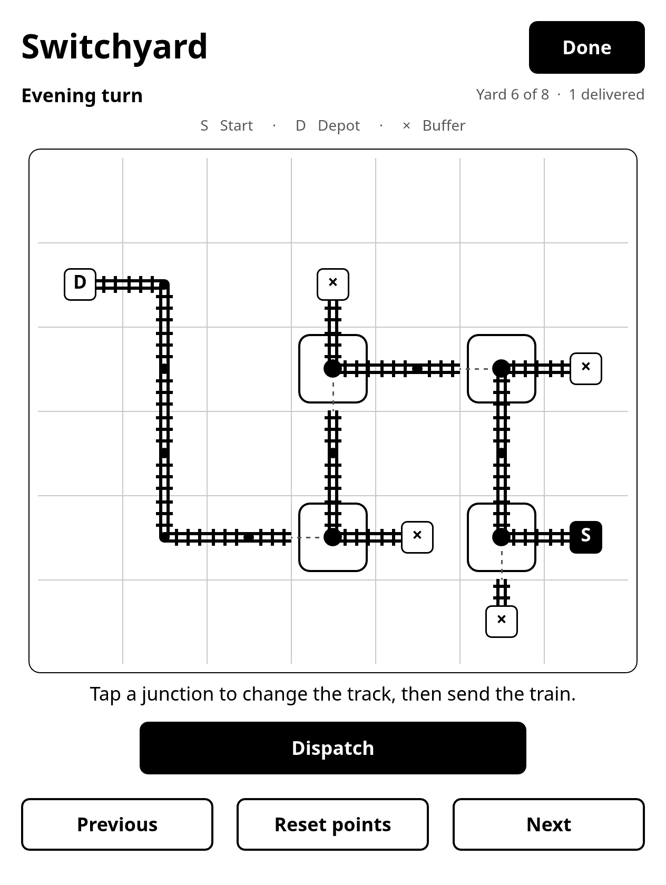

# Switchyard

Set junctions and send the train to its depot in eight original track puzzles for PrimitiveOS.



Follow the rails from **S** to **D**. Tap the outlined junctions to change their chosen branches. Solid rails are connected, and broken lines show the other branch. Tap **Dispatch** to trace the train's route. A buffer stops the train, and you can change your route and try again.

Use **Previous** and **Next** to visit yards in any order. Junction positions and deliveries are saved separately for each yard. **Reset points** restores a yard's starting junction positions.

## Install

Open **Store** from Primitive Launcher, search for **Switchyard**, and install it. See the [installation guide](INSTALL.md) for local testing.

## Desktop preview

From this repository, with the shared Tools and Launcher repositories beside it, run:

```sh
cargo test --locked --workspace
cargo run --locked -p switchyard-desktop -- docs/images
```

The preview dispatches a train to a buffer, changes its route, and confirms the delivery. [Delivered preview](docs/images/switchyard-delivered.png)

## Licence

The code is licensed under [PolyForm Noncommercial 1.0.0](LICENSE). Documentation and artwork are licensed under [CC BY-NC-SA 4.0](LICENSE-DOCS).
